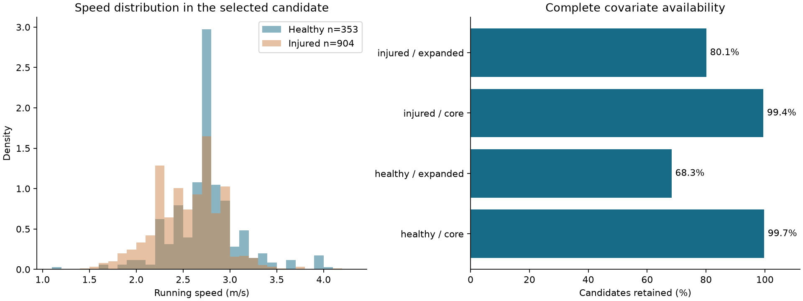

# Qué mejorar y cómo avanzar

Revisión local del Hito 1, 25 de octubre de 2026. Se mantiene la definición primaria de cohorte y no se procesan nuevos datos de movimiento. Ejecutar `python scripts/review_readiness.py` para regenerar esta revisión y la selección propuesta.

## 1. Resolver la comparabilidad antes de interpretar cinemática

En los 1257 candidatos seleccionados, la velocidad media es 2.739 m/s en controles y 2.554 m/s en lesionados. La diferencia observada obliga a examinar la velocidad en las futuras comparaciones; no demuestra qué variable causó la diferencia. La siguiente tabla utiliza una observación por participante y los valores disponibles para cada covariable.

| variable | healthy_n | injured_n | healthy_mean | injured_mean | injured_minus_healthy | standardized_mean_difference |
| --- | --- | --- | --- | --- | --- | --- |
| speed_m_s | 353 | 904 | 2.74 | 2.55 | -0.18 | -0.51 |
| age_analysis | 353 | 903 | 36.23 | 40.00 | 3.77 | 0.32 |
| Height_analysis | 352 | 901 | 171.65 | 172.16 | 0.51 | 0.05 |
| Weight_analysis | 352 | 901 | 69.37 | 71.45 | 2.08 | 0.16 |
| YrsRunning_analysis | 242 | 729 | 10.27 | 10.93 | 0.65 | 0.07 |

SMD = (media lesionados − media controles) / sqrt((varianza lesionados + varianza controles)/2), usando varianzas muestrales. Es un diagnóstico descriptivo de equilibrio entre grupos, no un efecto biomecánico, un umbral clínico ni una prueba de confusión causal. No se ajusta ningún modelo aquí.

Como sensibilidad descriptiva, la intersección de los intervalos percentil 5–95 de velocidad es 2.215–3.073 m/s. No se filtra la cohorte con este intervalo ni se propone como rango clínico.

| injury_status | participants | inside_shared_central_range | inside_percent | central_lower_m_s | central_upper_m_s |
| --- | --- | --- | --- | --- | --- |
| healthy | 353 | 291 | 82.44 | 2.21 | 3.07 |
| injured | 904 | 725 | 80.20 | 2.21 | 3.07 |

## 2. Evitar pérdidas automáticas por datos faltantes

Exigir todas las covariables ampliadas conserva 965/1257 candidatos y deja fuera 23.2%. Un conjunto básico conserva 1251, pero su elección debe responder a la pregunta científica y no solamente al tamaño disponible.

| injury_status | covariate_set | available_n | candidate_n | retained_percent |
| --- | --- | --- | --- | --- |
| healthy | all_candidates | 353 | 353 | 100 |
| healthy | core_covariates | 352 | 353 | 99.72 |
| healthy | expanded_covariates | 241 | 353 | 68.27 |
| injured | all_candidates | 904 | 904 | 100 |
| injured | core_covariates | 899 | 904 | 99.45 |
| injured | expanded_covariates | 724 | 904 | 80.09 |

Conjunto básico: velocidad, edad, género registrado, altura y peso. Ampliado: añade experiencia y nivel deportivo. No se imputa ni se cambia la cohorte; estas son comparaciones de disponibilidad. Preparar análisis básico/ampliado y estudiar selección por faltantes es preferible a asumir que los casos completos representan automáticamente a todos.

| injury_status | field | unavailable_n | denominator | unavailable_percent |
| --- | --- | --- | --- | --- |
| healthy | speed_m_s | 0 | 353 | 0 |
| healthy | age_analysis | 0 | 353 | 0 |
| healthy | Height_analysis | 1 | 353 | 0.28 |
| healthy | Weight_analysis | 1 | 353 | 0.28 |
| healthy | YrsRunning_analysis | 111 | 353 | 31.44 |
| healthy | gender | 0 | 353 | 0 |
| healthy | athletic_level | 50 | 353 | 14.16 |
| injured | speed_m_s | 0 | 904 | 0 |
| injured | age_analysis | 1 | 904 | 0.11 |
| injured | Height_analysis | 3 | 904 | 0.33 |
| injured | Weight_analysis | 3 | 904 | 0.33 |
| injured | YrsRunning_analysis | 175 | 904 | 19.36 |
| injured | gender | 1 | 904 | 0.11 |
| injured | athletic_level | 0 | 904 | 0 |

Cada participante tiene sus motivos de indisponibilidad en `tables/readiness_participant_missingness.csv`. Un dato registrado como desconocido y un valor numérico descartado por plausibilidad también impiden ciertos ajustes; no son lo mismo que una celda fuente vacía.

## 3. Revisar las etiquetas sin inventar diagnósticos

Hay 148 primeros registros de carrera desconocidos o discordantes. De ellos, 3 participantes tienen otra observación posterior elegible. La cola `tables/readiness_injury_review_queue.csv` conserva los textos originales y motivos de revisión. Resolverla significa revisar reglas y evidencias disponibles; si no hay evidencia suficiente, el estado sigue sin resolverse.

| scenario | participants | healthy | injured | added_vs_primary | selected_file_changes_shared_ids |
| --- | --- | --- | --- | --- | --- |
| current_conservative | 1257 | 353 | 904 | 0 | 0 |
| primary_fields_controls | 1258 | 354 | 904 | 1 | 0 |
| severity_only_exploratory | 1329 | 426 | 903 | 72 | 2 |

Los escenarios alternativos se calculan únicamente para sensibilidad. `primary_fields_controls` omite la evidencia secundaria para definir controles; `severity_only_exploratory` ignora conflictos entre campos y usa solo severidad. Ninguno sustituye la regla primaria conservadora ni convierte automáticamente una discrepancia en una persona sana. Los cambios de archivo seleccionado muestran que cambiar la regla también puede cambiar qué episodio entra en el análisis.

## 4. Usar tamaños de diagnóstico de la cohorte realmente seleccionada

Los recuentos históricos de cualquier sesión no deben asumirse como el tamaño disponible para una comparación con una sola observación por participante. En esta revisión, los siete diagnósticos mayores conservan sus recuentos al seleccionar el registro, pero disminuyen al exigir covariables ampliadas completas. Esta tabla incluye campos primarios/secundarios, deduplica persona–diagnóstico y mantiene por separado los casos completos ampliados. Las filas no son sumables.

| diagnosis | ever_participants | selected_participants | expanded_complete_participants | selected_n30_planning_flag |
| --- | --- | --- | --- | --- |
| itb syndrome | 102 | 102 | 83 | True |
| patellofemoral pain syndrome | 91 | 91 | 76 | True |
| plantar fasciitis | 61 | 61 | 53 | True |
| achilles tendonitis | 59 | 59 | 45 | True |
| calf muscle strain | 48 | 48 | 39 | True |
| hamstring muscle strain | 42 | 42 | 32 | True |
| medial tibial stress syndrome | 33 | 33 | 25 | True |
| bursitis | 25 | 25 | 21 | False |
| shin splints | 22 | 22 | 16 | False |
| osteoarthritis | 15 | 15 | 11 | False |
| low back pain | 15 | 14 | 10 | False |
| peroneal tendonitis | 10 | 10 | 9 | False |

La marca n≥30 es una ayuda de planificación, no un cálculo de potencia. La muestra utilizable podría disminuir tras QC biomecánico. Antes de elegir contrastes, comprobar tamaño efectivo, diagnósticos concurrentes, lado lesionado y distribución de velocidad. No combinar categorías por conveniencia estadística.

## 5. Próximo avance recomendado: piloto técnico de 30 personas

Se prepara `tables/phase02_pilot_manifest.csv`: 15 controles y 15 lesionados, sin repetir participantes. La selección determinista (semilla 42) rota por estratos de género y terciles de velocidad. En lesionados prioriza hasta dos personas por cada uno de los siete diagnósticos con más participantes y n≥30; cuando queda sitio incluye lesión inespecífica. La selección es intencional para probar la ingestión y cobertura de condiciones, no una muestra representativa ni un estudio de diferencias.

La selección propuesta incluye 0 archivos ya locales. Según el índice del ZIP, los 30 miembros suman 275.8 MB comprimidos y 584.7 MB sin comprimir. Los aún no locales suman aproximadamente 275.8 MB comprimidos, más cabeceras y solicitudes HTTP. **El manifiesto no descarga ni procesa esos archivos.** Frecuencia de muestreo y cobertura de marcadores aún no se conocen para la mayoría de la selección; deben verificarse durante el piloto.

Entregables del próximo piloto, tras revisar esta propuesta:

1. Adquisición selectiva con límites por lote, integridad y registro de fallos; no cargar todo el dataset en memoria.
2. Lectura de tutoriales oficiales pertinentes y registro de variables disponibles, unidades, signos, lado y definición temporal. Distinguir variables ya calculadas de las que requieren reconstrucción.
3. QC por archivo y por variable: trayectorias, calibración, eventos, ciclos aprovechables y advertencias del procesamiento oficial. No fijar un mínimo de ciclos sin justificarlo con ese flujo y el objetivo analítico.
4. Una tabla de características verificadas con persona, archivo, lado, nombre, valor, unidad, procedencia y estado QC. Elegir un conjunto pequeño e interpretable de cadera, rodilla y tobillo según lo realmente soportado.
5. Validar el piloto antes de ampliar. Las comparaciones ajustadas, curvas completas, fenotipos y clasificación tendrán etapas posteriores explícitas.

## 6. Uso concreto del complemento

BMC–RIC queda como referencia metodológica para compatibilidad entre laboratorios. No añade diagnósticos ni datos de género y no tiene un crosswalk validado a Calgary. Por ahora aporta un contrato de compatibilidad y un esquema de referencia; no aumenta el denominador ni justifica una validación externa independiente. Priorizaría ahora la calidad de la cohorte y el piloto antes de incorporar otra fuente.

## Decisión de avance

El siguiente hito debe producir características biomecánicas verificadas en una muestra pequeña y un informe QC, manteniendo asociaciones, diagnóstico y predicción futura como conceptos distintos. Esta revisión prepara ese trabajo; no declara validada la cinemática ni inicia ML. La definición primaria y los resultados originales del Hito 1 permanecen como referencia.
