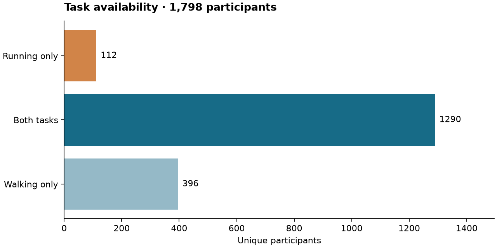
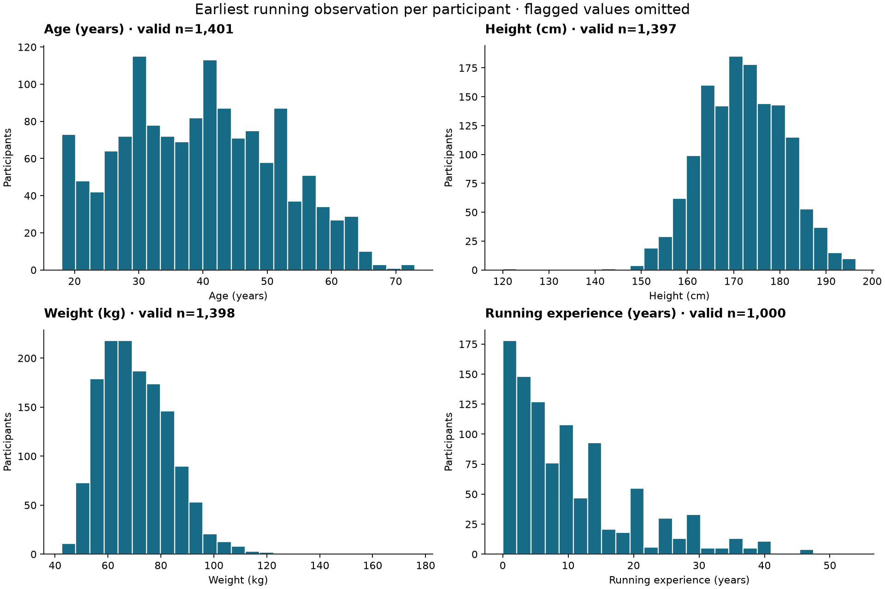
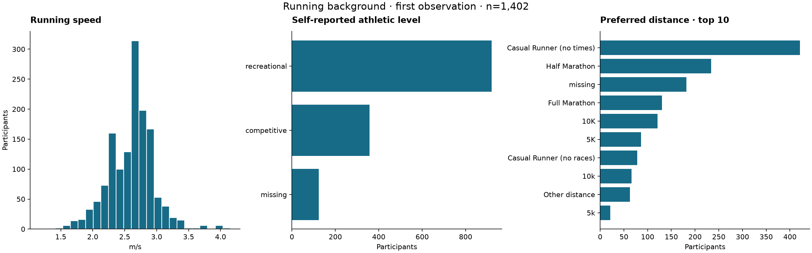
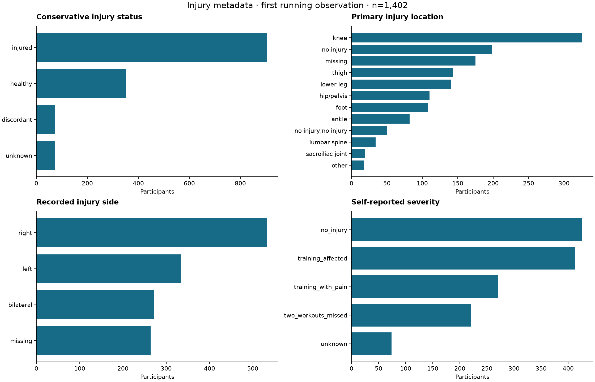
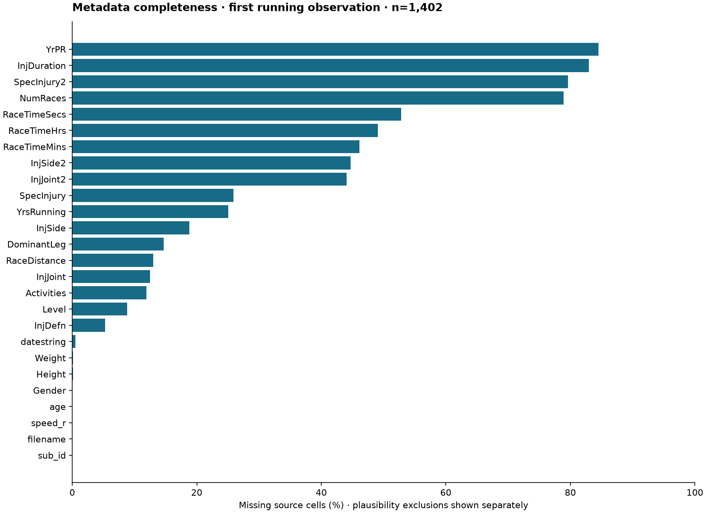

# Milestone 1 — Dataset & Cohort Understanding

Sports Rehabilitation & Human Performance · Running Biomechanics & Injury Phenotyping

Scope: metadata, archive manifest and a bounded JSON ingestion sample. No machine learning or advanced kinematic analysis was run. Acquisition pinned to [Figshare v1](https://doi.org/10.25452/figshare.plus.24255795.v1); study methods: [Ferber et al., Scientific Data 2024](https://doi.org/10.1038/s41597-024-04011-7). Report generated from local source files by `python scripts/run_milestone1.py`. Counts below are recalculated, not copied from the paper.

## What data do we actually have?

| metric | value |
| --- | --- |
| unique_participants | 1,798 |
| running_participants | 1,402 |
| walking_participants | 1,686 |
| both | 1,290 |
| running_only | 112 |
| walking_only | 396 |
| running_observations | 1,832 |
| walking_observations | 2,088 |
| archive_json_files | 2,506 |
| archive_participants | 1,798 |
| candidate_running_observations | 1,668 |
| candidate_running_participants | 1,257 |
| adjusted_complete_candidate_participants | 965 |
| sample_json_audited | 10 |
| full_usable_running_count | missing |
| participants_multiple_json | 334 |
| participants_multiple_days | 164 |
| participants_multiple_running_observations | 209 |
| running_participants_status_changes | 21 |
| timestamp_recoveries_from_filename | 11 |
| csv_filename_timestamp_disagreements | 190 |
| first_running_choice_changed_using_filename_time | 0 |

Metadata rows are task observations, not unique people or necessarily unique visits. The same JSON may contain both tasks. Distinct timestamps and distinct collection days are reported separately in `tables/participant_sessions.csv`. The two CSVs share 1414 participant-file keys. Archive files without metadata: 0; metadata files without archive members: 0.

The actual archive root is `reformat_data/`, despite the documentation naming ric_data. Only 10 JSON files have been opened. `full_usable_running_count` is deliberately unknown: the count of usable running observations after complete biomechanical QC cannot be established from metadata or a small sample. Candidate membership is provisional.

Structural ingestion sample (a convenience sample plus selected task/status examples; not representative):

| participant_id | filename | task | present | sampling_hz | markers | warnings |
| --- | --- | --- | --- | --- | --- | --- |
| 100001 | 20110531T161051.json | running | True | 200 | 30 |  |
| 100001 | 20110531T161051.json | walking | False | missing | 0 |  |
| 100002 | 20110601T140505.json | running | True | 200 | 30 |  |
| 100002 | 20110601T140505.json | walking | False | missing | 0 |  |
| 100003 | 20110601T095930.json | running | True | 200 | 30 |  |
| 100003 | 20110601T095930.json | walking | False | missing | 0 |  |
| 100004 | 20110203T120721.json | running | True | 200 | 30 |  |
| 100004 | 20110203T120721.json | walking | False | missing | 0 |  |
| 100005 | 20110208T120837.json | running | True | 200 | 30 |  |
| 100005 | 20110208T120837.json | walking | False | missing | 0 |  |
| 100017 | 20110330T143854.json | running | False | missing | 0 |  |
| 100017 | 20110330T143854.json | walking | True | 200 | 30 |  |
| 100058 | 20110628T161205.json | running | True | 200 | 30 |  |
| 100058 | 20110628T161205.json | walking | False | missing | 0 |  |
| 100099 | 20100203T142442.json | running | True | 200 | 30 |  |
| 100099 | 20100203T142442.json | walking | True | 120 | 30 |  |
| 100100 | 20100203T153154.json | running | True | 200 | 30 |  |
| 100100 | 20100203T153154.json | walking | True | 120 | 30 |  |
| 100550 | 20120704T124114.json | running | True | 200 | 30 |  |
| 100550 | 20120704T124114.json | walking | True | 200 | 30 |  |

The timestamp audit identifies 11 missing CSV times recovered from filenames and 190 task rows with conflicting CSV/filename times. CSV time is preferred when present; a sensitivity check selecting by filename time changed the earliest running file in 0 participants. These fields are not validated longitudinal follow-up dates. Review `tables/timestamp_audit.csv` before any temporal interpretation.

## Who is represented?

Primary descriptive unit: each participant's earliest running observation, n=1402. All-participant earliest records and all-observation sensitivity tables are also supplied. Later injury histories are retained; an earliest healthy observation does not imply lifelong absence of injury.

| variable | n | missing | mean | sd | min | p25 | median | p75 | max |
| --- | --- | --- | --- | --- | --- | --- | --- | --- | --- |
| age_analysis | 1401 | 1 | 39.45 | 12.00 | 18 | 30 | 39 | 48 | 73 |
| Height_analysis | 1397 | 5 | 172.04 | 9.14 | 120 | 165 | 172 | 179 | 196.50 |
| Weight_analysis | 1398 | 4 | 70.77 | 13.32 | 42.50 | 60.40 | 69.15 | 79.38 | 176 |
| speed_m_s | 1402 | 0 | 2.61 | 0.35 | 1.17 | 2.36 | 2.70 | 2.79 | 4.15 |
| YrsRunning_analysis | 1000 | 402 | 10.75 | 9.70 | 0 | 3 | 8 | 15 | 54 |
| InjDuration_analysis | 238 | 1164 | 360.24 | 793.12 | 0 | 60 | 147.50 | 365 | 10,000 |
| NumRaces_analysis | 296 | 1106 | 4.62 | 5.24 | 0 | 1 | 3 | 6 | 30 |

| category | n | denominator | percent | field |
| --- | --- | --- | --- | --- |
| female | 752 | 1402 | 53.64 | gender |
| male | 649 | 1402 | 46.29 | gender |
| unknown | 1 | 1402 | 0.07 | gender |
| right | 886 | 1402 | 63.20 | dominant_leg |
| left | 309 | 1402 | 22.04 | dominant_leg |
| missing | 206 | 1402 | 14.69 | dominant_leg |
| ambidextrous | 1 | 1402 | 0.07 | dominant_leg |
| recreational | 920 | 1402 | 65.62 | athletic_level |
| competitive | 358 | 1402 | 25.53 | athletic_level |
| missing | 124 | 1402 | 8.84 | athletic_level |
| injured | 903 | 1402 | 64.41 | injury_status |
| healthy | 351 | 1402 | 25.04 | injury_status |
| discordant | 74 | 1402 | 5.28 | injury_status |
| unknown | 74 | 1402 | 5.28 | injury_status |
| no_injury | 425 | 1402 | 30.31 | severity |
| training_affected | 413 | 1402 | 29.46 | severity |
| training_with_pain | 270 | 1402 | 19.26 | severity |
| two_workouts_missed | 220 | 1402 | 15.69 | severity |
| unknown | 74 | 1402 | 5.28 | severity |

These are clinic/research volunteers measured on a treadmill. There is no population-representative sampling frame. Height, weight, age and running experience contain implausible entries. Original values are retained and flagged; no outlier is silently corrected. Broad plausibility bounds are engineering decisions, not validated clinical thresholds.

| variable | running_observations_flagged | running_first_flagged | all_observations_flagged |
| --- | --- | --- | --- |
| age | 1 | 1 | 2 |
| Height | 5 | 3 | 51 |
| Weight | 3 | 2 | 35 |
| YrsRunning | 51 | 51 | 107 |
| InjDuration | 1 | 1 | 1 |
| NumRaces | 0 | 0 | 0 |
| speed | 0 | 0 | 0 |
| identity | 0 | 0 | 0 |

## Which injuries are sufficiently represented?

The following counts are unique running participants EVER recording each specific diagnosis in an injury-positive observation, using primary and secondary fields. A person may appear in several rows. Only README-supported aliases are merged. N >= 30 is an initial descriptive screening rule, not a power calculation or evidence of a diagnostic biomarker.

| diagnosis | participants | exploratory_n30_screen |
| --- | --- | --- |
| itb syndrome | 102 | True |
| patellofemoral pain syndrome | 91 | True |
| plantar fasciitis | 61 | True |
| achilles tendonitis | 59 | True |
| calf muscle strain | 48 | True |
| hamstring muscle strain | 42 | True |
| medial tibial stress syndrome | 33 | True |
| bursitis | 25 | False |
| shin splints | 22 | False |
| low back pain | 15 | False |
| osteoarthritis | 15 | False |
| peroneal tendonitis | 10 | False |
| tibia stress fracture | 9 | False |
| ligament sprain | 9 | False |
| disc protrusion | 8 | False |
| disc degeneration | 8 | False |
| si joint pain | 8 | False |
| ligament tear/rupture acl | 8 | False |
| hip flexor strain | 8 | False |
| meniscal tear medial | 7 | False |
| muscle spasm | 7 | False |
| patellar tedonitis | 7 | False |
| patellar tendonitis | 6 | False |
| groin muscle strain | 5 | False |
| compartment syndrome | 5 | False |

The full diagnosis inventory, raw variants, joint/side/severity distributions and secondary injuries are in `tables/`. Generic pain, other, tendonitis and form-placeholder text remain visible descriptively but do not define a specific diagnosis group. Recorded diagnoses are not independently adjudicated here. Missing/discordant injury status is kept distinct from controls. Status changes across running observations occur in 21 participants.

Duration among injury-positive earliest running observations (days, no imputation):

| variable | n | missing | mean | sd | min | p25 | median | p75 | max |
| --- | --- | --- | --- | --- | --- | --- | --- | --- | --- |
| InjDuration_analysis | 230 | 673 | 362.10 | 803.02 | 1 | 60 | 150 | 365 | 10000 |

Speed by earliest running injury status (m/s):

| injury_status | count | mean | std | median | min | max |
| --- | --- | --- | --- | --- | --- | --- |
| discordant | 74 | 2.68 | 0.14 | 2.70 | 1.93 | 2.99 |
| healthy | 351 | 2.74 | 0.37 | 2.72 | 1.17 | 4.09 |
| injured | 903 | 2.55 | 0.36 | 2.59 | 1.45 | 4.15 |
| unknown | 74 | 2.62 | 0.22 | 2.71 | 2.05 | 3.15 |

Missingness refers to source cells, not failure to satisfy plausibility checks. Injury duration and secondary injury fields can be structurally inapplicable. Analysis fields additionally mask flagged values. See all missingness tables and `quality_flags.csv`.

## What can this dataset legitimately answer?

It supports descriptive and, after QC, cross-sectional investigation of running kinematics associated with current injury status and recorded diagnoses. Repeated observations permit within-dataset robustness checks. Future biomechanical phenotypes may cut across diagnoses, subject to stability and interpretability assessment. Dataset reference distributions can be explored after sample definition and speed/covariate evaluation.

The metadata-supported primary candidate contains 1257 participants with an eligible indexed running observation. Select the earliest eligible observation after exclusions, preserving all later observations for sensitivity analyses. This differs from the earliest-observation descriptive tables. 965 candidates also have the currently required complete plausible covariates. Neither count is a fully motion-QC-confirmed cohort. See `../docs/cohort_definition.md` and `../data/processed/running_cohort_audit.csv` for every row and exclusion.

### Complementary source prepared in parallel

The official [BMC–RIC interlaboratory supplement](https://github.com/regifukuchi/BMC-RIC-running-biomechanics) is acquired separately, pinned to commit `21f5a4607c9e4f6a365caa6e6d85c96787517844` with Git-blob/SHA-256 integrity checks and upstream CC BY 4.0 attribution. The observed metadata contain 1614 rows, 8 fields and 0 missing cells.

| Group | source_rows | participants |
| --- | --- | --- |
| BMC | 791 | 23 |
| RIC | 823 | 23 |

Observed fields: Group, Subject, Trial, Filename, Speed, Age, Height, Mass. Subject numbers repeat across centres, so identity requires Group + Subject. Rows are labelled Trial in the source; they must not be counted as independent participants or assumed to be separate clinical sessions. There are no injury-status, diagnosis or gender columns and no verified crosswalk to Calgary sub_id. The notebook is retained as source documentation and was not executed. Waveform data were not downloaded or analyzed.

This complement prepares a protocol-compatibility benchmark from the outset. It does not increase the primary Calgary cohort, fill missing patient fields, or establish independent external validation. Possible RIC overlap remains unresolved. See `../docs/complementary_sources.md` and `../docs/external_compatibility.md` for source-specific definitions and limitations; the separate metadata profile can be regenerated with `python scripts/profile_external.py`.

## What can it NOT answer?

There is no prospective injury follow-up here. Associations cannot establish causation or future injury risk. Classification would distinguish biomechanical patterns associated with current injury status within this dataset; it would not demonstrate clinical diagnosis. Statistical significance does not imply clinical relevance, group averages do not define individual profiles, and biomechanical differences do not establish diagnostic biomarkers. The contralateral limb cannot automatically be treated as healthy. No participant-level merge with unrelated datasets is justified.

The JSON sample provides structural ingestion evidence only. Full-cohort marker completeness, gait-event quality, usable cycle count, and motion-derived features remain unverified. Potential selection, repeated-session dependence, diagnosis imbalance, speed confounding, missingness and equipment/marker-set differences require explicit analysis.

## What should Phase 2 analyze?

1. Review the unresolved injury records, alias mapping, plausibility screens and candidate cohort; define minimum usable-cycle and marker criteria with the official pipeline.
2. Expand to a stratified small sample across status, diagnosis, gender, speed and marker availability; validate static-array orientation, task branches, sampling frequencies, and official event warnings.
3. Audit speed overlap and demographic/experience differences before any adjusted group comparisons. Specify covariates and missing-data sensitivity analyses.
4. Choose interpretable hip/knee/ankle features only after verifying the actual descriptive-variable definitions and coordinate conventions. Preserve whole waveforms for a later milestone.
5. Plan effect sizes, uncertainty and multiplicity control. Treat n30 diagnosis screening as provisional; conduct precision/power and subgroup feasibility assessments before inference.
6. Use the complementary interlaboratory source as a separate compatibility benchmark, subject to its source-specific protocol and possible RIC overlap. See `../docs/complementary_sources.md`.

**Review gate: stop after Milestone 1.** No joint-angle reconstruction, waveform inference, clustering or classification has been performed.

Verification methods and their limits are recorded in [validation.md](validation.md).
