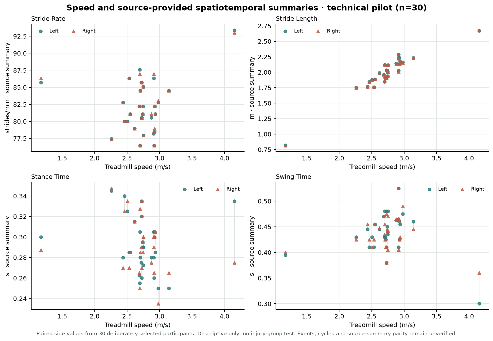

# Hito 2.1 — Descripción exploratoria del piloto disponible

Este avance usa solamente el piloto técnico local de 30 personas (15 controles y 15 corredores con lesión según metadatos) y los 13 resúmenes bilaterales guardados por la fuente. Es una descripción agregada para entender cobertura, escala y dependencia potencial de velocidad; **no es una comparación clínica de grupos ni una validación biomecánica**.

## Qué muestran estos archivos

- 30 personas, una fila por persona; 26 combinaciones de variable y lado resumidas.
- Cada estadístico procede de `dv_r` en los JSON originales. No recalcula cinemática ni reconstruye ciclos.
- Los 30 ensayos pasaron QC estructural. El recuento de eventos/ciclos utilizables sigue sin establecerse.
- La tabla presenta mediana y rango intercuartílico (Q1–Q3) por lado; las variables angulares conservan signos y convenciones de la fuente.
- El gráfico enlaza los valores izquierdo/derecho de cada participante para cuatro variables espaciotemporales y muestra su velocidad. No identifica participantes ni codifica su estado de lesión.

## Resúmenes por lado

| Variable fuente | Unidad | n izq. | Mediana izq. [Q1, Q3] | n der. | Mediana der. [Q1, Q3] |
| --- | --- | ---: | ---: | ---: | ---: |
| STRIDE_RATE | strides/min | 30 | 81.64 [80.00, 84.96] | 30 | 81.64 [80.00, 84.96] |
| STRIDE_LENGTH | m | 30 | 2.01 [1.89, 2.14] | 30 | 2.01 [1.89, 2.14] |
| SWING_TIME | s | 30 | 0.44 [0.42, 0.46] | 30 | 0.44 [0.41, 0.46] |
| STANCE_TIME | s | 30 | 0.29 [0.28, 0.30] | 30 | 0.29 [0.27, 0.30] |
| ANKLE_DF_PEAK_ANGLE | deg | 30 | 19.97 [17.93, 22.64] | 30 | 21.26 [19.95, 23.32] |
| ANKLE_EVE_PEAK_ANGLE | deg | 30 | -5.83 [-8.76, -4.64] | 30 | -6.53 [-8.63, -4.84] |
| ANKLE_ROT_PEAK_ANGLE | deg | 30 | 2.50 [-1.56, 5.49] | 30 | 1.28 [-2.18, 4.28] |
| KNEE_FLEX_PEAK_ANGLE | deg | 30 | -41.65 [-46.39, -36.91] | 30 | -42.37 [-45.33, -39.14] |
| KNEE_ADD_PEAK_ANGLE | deg | 30 | -3.23 [-5.10, -2.10] | 30 | -4.77 [-6.24, -2.29] |
| KNEE_ROT_PEAK_ANGLE | deg | 30 | -10.43 [-14.57, -4.62] | 30 | -12.68 [-17.53, -11.21] |
| HIP_EXT_PEAK_ANGLE | deg | 30 | -13.75 [-17.23, -7.13] | 30 | -13.09 [-17.30, -8.84] |
| HIP_ADD_PEAK_ANGLE | deg | 30 | 9.15 [5.35, 10.88] | 30 | 6.62 [5.16, 10.19] |
| HIP_ROT_PEAK_ANGLE | deg | 30 | 15.03 [9.40, 17.41] | 30 | 17.75 [12.34, 20.10] |

## Diferencias pareadas espaciotemporales

Las diferencias izquierda–derecha se muestran solo para variables espaciotemporales con unidad compartida. No se etiquetan como asimetría clínica. Para los ángulos no se calcula un índice bilateral porque la interpretación debe respetar las transformaciones y signos específicos de cada variable en el código fuente.

| Variable | Pares | Mediana izq. − der. | Diferencia absoluta mediana [Q1, Q3] |
| --- | ---: | ---: | ---: |
| STRIDE_RATE | 30 | 0.000 strides/min | 0.000 strides/min [0.000, 0.191] |
| STRIDE_LENGTH | 30 | 0.000 m | 0.000 m [0.000, 0.004] |
| SWING_TIME | 30 | 0.000 s | 0.005 s [0.003, 0.015] |
| STANCE_TIME | 30 | 0.000 s | 0.007 s [0.003, 0.015] |

## Relación descriptiva con velocidad



La figura ayuda a ver si la velocidad acompaña cambios en zancada, apoyo o balanceo dentro de este piloto pequeño. Los dos lados de cada persona son observaciones emparejadas; no deben contarse como 60 personas. La selección 15/15 y las diferencias de velocidad del marco de cohorte limitan cualquier lectura conjunta. No se ajustan modelos, no se calculan valores p y no se formula una conclusión sobre lesión.

## Qué puede y qué no puede concluirse

Este análisis permite describir qué valores fuente están disponibles y planear una siguiente comprobación. No confirma que los eventos touchdown/toe-off o los ciclos retenidos sean correctos; tampoco garantiza que los resúmenes fueran producidos por la misma versión de código que se inspeccionó. Por ello no establece diferencias por lesión, fenotipos, umbrales clínicos o riesgo futuro.

La prioridad científica sigue siendo ejecutar el flujo oficial y comparar eventos, ciclos retenidos y resúmenes en los mismos archivos. Después, si el QC lo permite, se podrá decidir qué parte de la cohorte tiene cobertura biomecánica suficiente.

## Reproducibilidad y atribución

Regenerar este informe y sus tablas/figura desde la raíz del repositorio:

```powershell
.venv\Scripts\python.exe scripts\summarize_pilot_descriptives.py
```

Los datos y definiciones de origen corresponden a Ferber et al., *Running Injury Clinic Kinematic Dataset*, v1 (2024), DOI [10.25452/figshare.plus.24255795.v1](https://doi.org/10.25452/figshare.plus.24255795.v1), CC BY 4.0. Los valores son resúmenes derivados del dataset y se mantienen atribuidos; no se vuelven a publicar filas ni identificadores en esta descripción agregada. Véase la [revisión metodológica del piloto](milestone_02_pilot_summary.md) y el [estado de la validación oficial pendiente](milestone_03_official_events_validation.md).

### Archivos generados

- `reports/tables/pilot_descriptive_summary.csv`
- `reports/tables/pilot_spatiotemporal_paired.csv`
- `reports/figures/pilot_speed_descriptives.png`
