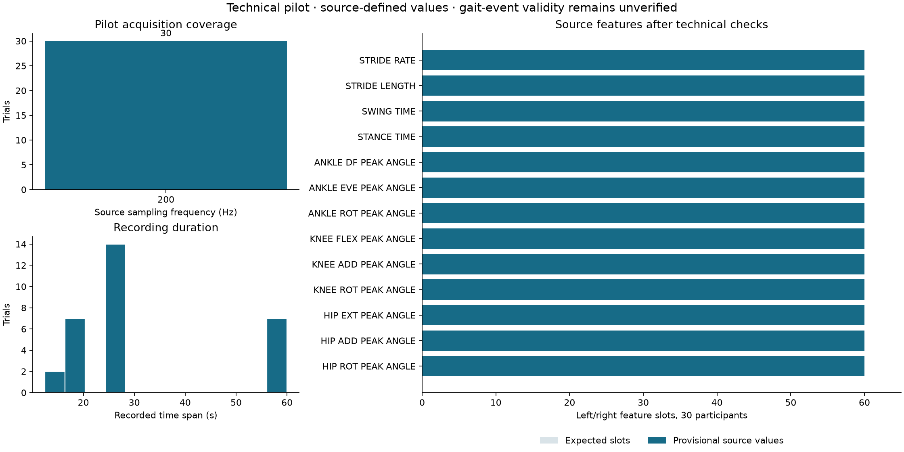

# Hito 2 — Piloto técnico de características biomecánicas

Sports Rehabilitation & Human Performance · Running Biomechanics & Injury Phenotyping

Se adquirieron y revisaron 30 JSON de la selección previamente definida: 15 controles y 15 corredores con lesión según la regla de metadatos. La muestra es intencional para comprobar el procesamiento; no estima prevalencia ni diferencias clínicas entre grupos. Se utiliza una observación por participante y se mantiene la identidad persona–archivo–lado.

## Resultado del piloto

| metric | value |
| --- | --- |
| participants | 30 |
| features_per_side | 13 |
| expected_bilateral_slots | 780 |
| finite_source_values | 780 |
| provisionally_available_values | 780 |
| structural_pass_trials | 30 |
| trials_with_temporal_review | 0 |
| placeholder_names_identified_in_source | 36 |
| observed_placeholder_records | 2160 |
| nonzero_placeholder_records | 0 |
| independently_validated_events_trials | 0 |

Los 13 tipos de características producen 26 columnas bilaterales, además de identificadores y campos QC. Los valores finitos de la tabla larga se conservan como los entrega `dv_r`, incluso si requieren revisión. `analysis_value` enmascara campos ausentes/no finitos, tiempos o tasas no positivos, ángulos exactamente cero pendientes de revisión, observaciones con alertas estructurales y lados con una alerta de coherencia temporal. Un cero angular no se declara automáticamente un error: se retiene y queda pendiente de revisión.

**El piloto verifica adquisición, esquema, vínculo con metadatos, definiciones/unidades documentadas y consistencia técnica. No equivale a una validación biomecánica completa.** El número de observaciones con eventos/ciclos plenamente validados continúa sin establecerse.

## Qué características están documentadas

| feature | domain | unit | phase | source_line_start | source_line_end |
| --- | --- | --- | --- | --- | --- |
| STRIDE_RATE | spatiotemporal | strides/min | successive ipsilateral touchdowns | 776 | 781 |
| STRIDE_LENGTH | spatiotemporal | m | successive ipsilateral touchdowns | 782 | 787 |
| SWING_TIME | spatiotemporal | s | toe-off to next ipsilateral touchdown | 788 | 801 |
| STANCE_TIME | spatiotemporal | s | touchdown to toe-off | 802 | 807 |
| ANKLE_DF_PEAK_ANGLE | ankle | deg | whole normalized stance | 848 | 865 |
| ANKLE_EVE_PEAK_ANGLE | ankle | deg | whole normalized stance | 869 | 874 |
| ANKLE_ROT_PEAK_ANGLE | ankle | deg | whole normalized stance | 970 | 975 |
| KNEE_FLEX_PEAK_ANGLE | knee | deg | first 70 of 101 normalized stance samples | 998 | 1015 |
| KNEE_ADD_PEAK_ANGLE | knee | deg | whole normalized stance | 1019 | 1024 |
| KNEE_ROT_PEAK_ANGLE | knee | deg | whole normalized stance | 1063 | 1068 |
| HIP_EXT_PEAK_ANGLE | hip | deg | whole normalized stance | 1091 | 1110 |
| HIP_ADD_PEAK_ANGLE | hip | deg | first 60 of 101 normalized stance samples | 1114 | 1133 |
| HIP_ROT_PEAK_ANGLE | hip | deg | whole normalized stance | 1142 | 1159 |

El catálogo completo, con expresiones exactas y SHA-256 del código, está en `tables/pilot_feature_registry.csv` y `../handoff/pilot_feature_catalog.csv`. Se revisaron los tutoriales oficiales 1 y 2, además de `gait_steps.m` y `gait_kinematics.m`; sus originales permanecen intactos y las copias de texto extraídas están en `data/interim/official_tutorials/`.

## Hallazgos metodológicos que cambian cómo interpretar los datos

1. La normalización oficial de estas curvas va de touchdown a toe-off: 101 puntos de **apoyo**, no de todo el ciclo. La flexión máxima de rodilla usa los primeros 70 puntos; la aducción máxima de cadera, los primeros 60. No se sustituyen por picos globales.
2. `STRIDE_RATE` representa zancadas/minuto por lado. Aunque el tutorial usa nombres temporales terminados en `_hz`, sus etiquetas y la fórmula `60*hz/diff(TD)` confirman la unidad. No se trata como pasos/minuto o Hz.
3. Los ángulos salen en grados del código de cinemática. Se preservan los signos originales; por ejemplo, la definición de flexión de rodilla incluye un signo negativo. No se aplica valor absoluto ni una conversión automática de rotación interna/externa.
4. La matriz oficial se inicializa en cero y deja 36 nombres de campo sin asignación en el código revisado. Esos campos no entran en la selección; un cero reservado no es una medición normal. La coincidencia con el código actual no demuestra qué versión produjo cada JSON histórico.
5. Los valores exportados son los resúmenes originales, no máximos recalculados de marcadores ni valores individuales de cada ciclo. Los eventos retenidos, sus advertencias y el número válido de ciclos no aparecen como salidas verificadas en estos JSON.

## Calidad por archivo y trazabilidad

| participant_id | qc_status | sampling_hz | time_span_s | provisionally_available_slots | temporal_review_sides |
| --- | --- | --- | --- | --- | --- |
| 101111 | structural_pass | 200 | 25.00 | 26 | 0 |
| 100288 | structural_pass | 200 | 19.14 | 26 | 0 |
| 200244 | structural_pass | 200 | 25.00 | 26 | 0 |
| 101067 | structural_pass | 200 | 25.00 | 26 | 0 |
| 100279 | structural_pass | 200 | 12.46 | 26 | 0 |
| 101577 | structural_pass | 200 | 25.00 | 26 | 0 |
| 101302 | structural_pass | 200 | 59.99 | 26 | 0 |
| 102009 | structural_pass | 200 | 59.99 | 26 | 0 |
| 100246 | structural_pass | 200 | 20.00 | 26 | 0 |
| 100504 | structural_pass | 200 | 59.99 | 26 | 0 |
| 100721 | structural_pass | 200 | 59.99 | 26 | 0 |
| 101058 | structural_pass | 200 | 25.00 | 26 | 0 |
| 101054 | structural_pass | 200 | 25.00 | 26 | 0 |
| 100503 | structural_pass | 200 | 20.00 | 26 | 0 |
| 100755 | structural_pass | 200 | 59.99 | 26 | 0 |
| 201224 | structural_pass | 200 | 25.00 | 26 | 0 |
| 100198 | structural_pass | 200 | 14.65 | 26 | 0 |
| 200354 | structural_pass | 200 | 25.00 | 26 | 0 |
| 100646 | structural_pass | 200 | 59.99 | 26 | 0 |
| 101174 | structural_pass | 200 | 20.00 | 26 | 0 |
| 100663 | structural_pass | 200 | 59.99 | 26 | 0 |
| 101761 | structural_pass | 200 | 25.00 | 26 | 0 |
| 101250 | structural_pass | 200 | 25.00 | 26 | 0 |
| 200241 | structural_pass | 200 | 25.00 | 26 | 0 |
| 100341 | structural_pass | 200 | 20.00 | 26 | 0 |
| 201092 | structural_pass | 200 | 25.00 | 26 | 0 |
| 100034 | structural_pass | 200 | 20.00 | 26 | 0 |
| 100054 | structural_pass | 200 | 20.00 | 26 | 0 |
| 101056 | structural_pass | 200 | 25.00 | 26 | 0 |
| 200366 | structural_pass | 200 | 25.00 | 26 | 0 |

Cada archivo se comprueba contra la adquisición mediante SHA-256; la adquisición valida además tamaño y CRC del miembro ZIP. Se examinan marcadores requeridos, formas, frames, frecuencia, valores no finitos/cero, vectores estáticos, pares anatómicos coincidentes y geometría no colineal de clusters. La variación de distancias entre marcadores rígidos se describe mediante MAD relativa; 5% es un disparador técnico de revisión, no un umbral clínico validado. La coherencia entre duración de apoyo/balanceo, tasa de zancada, longitud y velocidad se revisa también al 5%; medianas agregadas pueden no obedecer exactamente las identidades. No se corrigen los originales para hacerlas coincidir.

La caché por archivo incorpora SHA-256 del JSON, código de extracción/QC, definiciones oficiales, metadatos y velocidad vinculada. Permite repetir la exportación sin volver a parsear trayectorias, invalidándose cuando cambian sus dependencias. Los JSON se procesan secuencialmente y los archivos completos del dataset no se descargan.

## Archivos entregados

- [Tabla larga con valores originales, unidades y QC](../data/processed/pilot_features_long.csv).
- [Matriz bilateral con valores provisionalmente disponibles](../data/processed/pilot_features_wide.csv).
- [QC por archivo](tables/pilot_qc_trials.csv), [coherencia temporal](tables/pilot_temporal_consistency.csv) y [geometría de clusters](tables/pilot_qc_geometry.csv).
- [Inventario completo de campos almacenados](tables/pilot_stored_variable_inventory.csv) y [cobertura de la selección](tables/pilot_feature_coverage.csv).
- [Procedencia de la adquisición y caché](tables/pilot_acquisition_status.csv).

## Qué falta antes de ampliar o comparar grupos

Ejecutar el procesamiento oficial en un entorno MATLAB compatible, o validar una implementación equivalente contra salidas oficiales, es necesario para verificar reconstrucción, eventos, advertencias y ciclos aprovechables. Los tutoriales se inspeccionaron, no se ejecutaron en MATLAB. No se inventa un número de ciclos a partir de tasa × duración ni se declara completado ese QC.

Mantener las observaciones con advertencias en una cola de revisión y definir la política de ciclos/variables con evidencia. Después, revisar velocidad/edad y datos faltantes antes de comparaciones ajustadas con tamaños de efecto e incertidumbre. Esta muestra técnica no sustenta inferencia de diferencias entre diagnósticos, fenotipos clínicos, diagnóstico automático o predicción futura. BMC–RIC permanece separado y no valida la independencia del piloto.

No se ha reconstruido cinemática, ajustado modelos de lesión, realizado clustering ni llevado a cabo inferencia de curvas. El siguiente paso recomendado es la validación de eventos y paridad con el procesamiento oficial, antes de procesar la cohorte completa.
